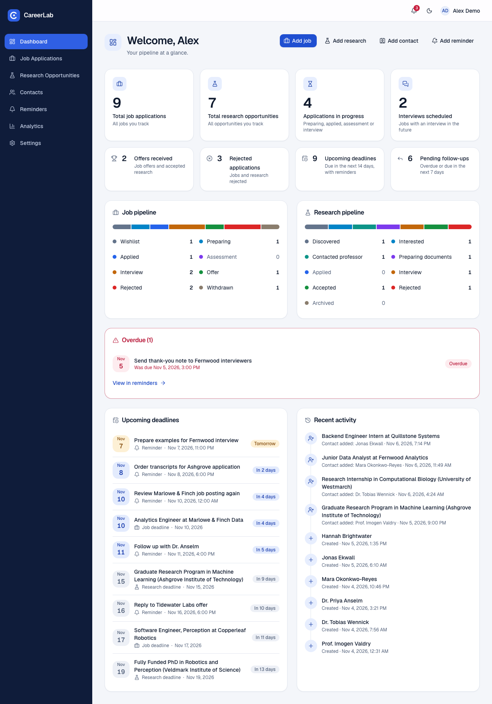
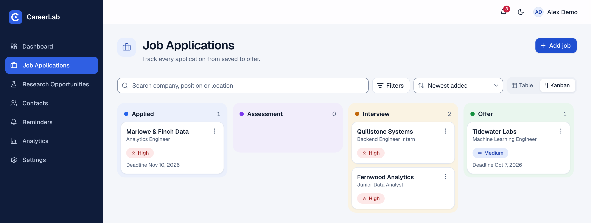
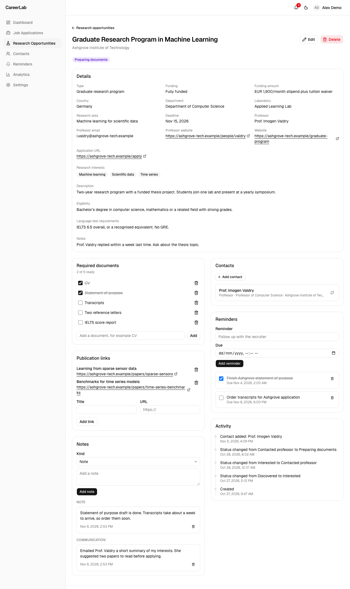
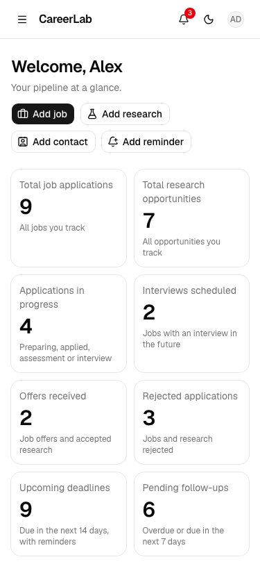
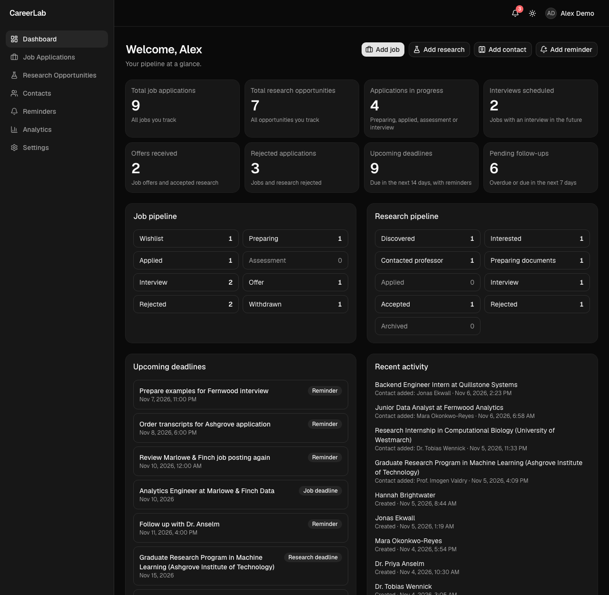

# CareerLab

CareerLab is a private workspace for tracking job applications, research
opportunities, contacts, deadlines and reminders. It replaces the spreadsheet,
bookmarks and notes a student or early-career professional would otherwise juggle.

Live demo: coming soon



The screenshots in this repo use invented data from the demo seed script.

## Features

- Register, log in, log out, edit your profile and change your password.
- Create, view, edit and delete job applications, research opportunities, contacts,
  reminders and notes.
- Move jobs and research opportunities between statuses from a form or by dragging cards
  on a Kanban board. Each card also has a status menu that works from the keyboard.
- Research detail pages have a required-documents checklist and publication links.
- Reminders have overdue, upcoming and completed views, with search and sorting. The header
  bell shows incomplete reminders that are overdue or due in the next 3 days.
- A dashboard with eight summary numbers, job and research pipelines, upcoming deadlines,
  a section for overdue reminders (shown only when there are some) and recent activity, all
  computed from the database on each request. "Today" is the browser's local date.
- An analytics page with status charts and monthly application counts.
- Search, filters, sorting and pagination on every list. Filters live in the URL.
- An activity timeline on each job, research opportunity and contact.
- Light and dark themes, and layouts for desktop, tablet and phone widths.
- Every record belongs to one user. Another user's record returns `404`.

| Kanban board | Research detail |
|---|---|
|  |  |

| Phone width (375px) | Dark mode |
|---|---|
|  |  |

## Tech stack

- **Backend:** Python 3.12, FastAPI, SQLAlchemy 2, Pydantic 2, Alembic, Argon2 password hashes,
  signed JWT in an HttpOnly cookie.
- **Database:** PostgreSQL 16.
- **Frontend:** Next.js (App Router), TypeScript, Tailwind CSS, shadcn/ui components,
  TanStack Query, React Hook Form, Zod, Recharts, dnd-kit.
- **Tests:** pytest against a real PostgreSQL database, Playwright for end-to-end tests.
- **Tooling:** Docker Compose, GitHub Actions (lint, type checks, tests, build, gitleaks).

See [docs/architecture.md](docs/architecture.md) for how the pieces fit together.

## Quick start with Docker

You need Docker with Compose. Ports 3000, 8000 and 5433 must be free.

```bash
git clone https://github.com/roybipro/careerlab.git
cd careerlab
cp .env.example .env
docker compose up --build
```

Then open:

- the app: <http://localhost:3000>
- the API docs (Swagger): <http://localhost:8000/docs>
- the health check: <http://localhost:8000/health>

The first start builds three images and applies the database migrations, so it takes a few
minutes. `.env.example` leaves `JWT_SECRET` empty. Compose then uses a development-only
secret, so this setup is for local use only: the API refuses that secret (and the other values
published in this repository) when `COOKIE_SECURE=true` or on Render. Compose publishes the
database (5433) and the API (8000) on `127.0.0.1` only, so they are not reachable from other
machines. Register an account on the login page to start.

### Optional: load demo data

The seed script creates one account (`demo@example.com`) with invented companies, people and
dates relative to today. You choose the password, and it is never stored in the repo:

```bash
docker compose exec -e DEMO_PASSWORD='choose-a-password' api python scripts/seed_demo.py
```

The password must be 10 to 128 characters. The script only runs against `localhost` or the
Compose database host, and it stops if the account already exists. Pass `--allow-remote` to
override the host check. [docs/demo-script.md](docs/demo-script.md) shows how to remove the
account and seed again.

To stop the stack, press Ctrl+C or run `docker compose down`. Add `-v` to delete the database
volume as well.

## Local development without Docker for the app

The database still runs in Docker. The backend and frontend run on your machine.

```bash
cp .env.example .env
# Set JWT_SECRET in .env, at least 32 characters. Generate one with:
python3 -c "import secrets; print(secrets.token_urlsafe(48))"

docker compose up -d db

# Backend (Python 3.12), in one terminal
cd backend
python3.12 -m venv .venv
source .venv/bin/activate
# Install the dependencies listed in pyproject.toml (the project is not packaged for pip)
python -c "import tomllib; p = tomllib.load(open('pyproject.toml', 'rb'))['project']; print('\n'.join(p['dependencies'] + p['optional-dependencies']['dev']))" > .venv/requirements.txt
pip install -r .venv/requirements.txt
alembic upgrade head
uvicorn app.main:app --reload

# Frontend (Node 24), in another terminal
cd frontend
npm ci
npm run dev
```

The frontend is at <http://localhost:3000> and proxies `/api/v1/*` to the backend at
`http://localhost:8000`. Set `API_URL` in `.env` to point it somewhere else; it is read at
build time. Every variable is described in [.env.example](.env.example).

## Tests

Backend tests need the database from Compose (`docker compose up -d db`), which also creates
a separate `careerlab_test` database. The tests never touch the `careerlab` database.

```bash
cd backend
source .venv/bin/activate
ruff check .
mypy app
pytest
```

Frontend checks:

```bash
cd frontend
npm run lint
npm run typecheck
npm run build
```

End-to-end tests run against the full stack. Start it first with `docker compose up -d --build`.
The tests register several users from one IP, so start the stack with a higher registration
limit than the default of 5 per minute:

```bash
RATE_LIMIT_REGISTER_PER_MINUTE=1000 docker compose up -d --build
cd frontend
npx playwright install chromium
npm run test:e2e
```

## Documentation

- [Architecture](docs/architecture.md)
- [Database and ER diagram](docs/database.md)
- [API reference](docs/api.md)
- [Two-minute demo script](docs/demo-script.md)
- [Contributing](CONTRIBUTING.md)

## Known limits

- The API may be hosted on a free tier that sleeps when idle, so the first request after a
  pause can be slow. Loading screens and the login and register buttons say so after about
  10 seconds.
- There is no password reset (it needs email). Someone who forgets their password loses
  access to their data, and the register page says so.
- Rate limit counters are kept in memory. They reset when the API restarts and only work with
  a single API instance.
- A stolen session cookie stays valid until it expires after 7 days or the password changes.
- Registration is open and emails are not verified, so an address is not confirmed as real.
- Deletes are permanent. There is no trash, soft delete or account deletion.
- There are no email reminders or background jobs. Reminder alerts are calculated when a page
  asks for them.

## License

[MIT](LICENSE)
