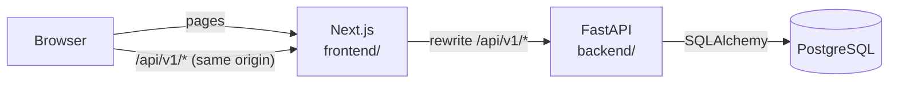
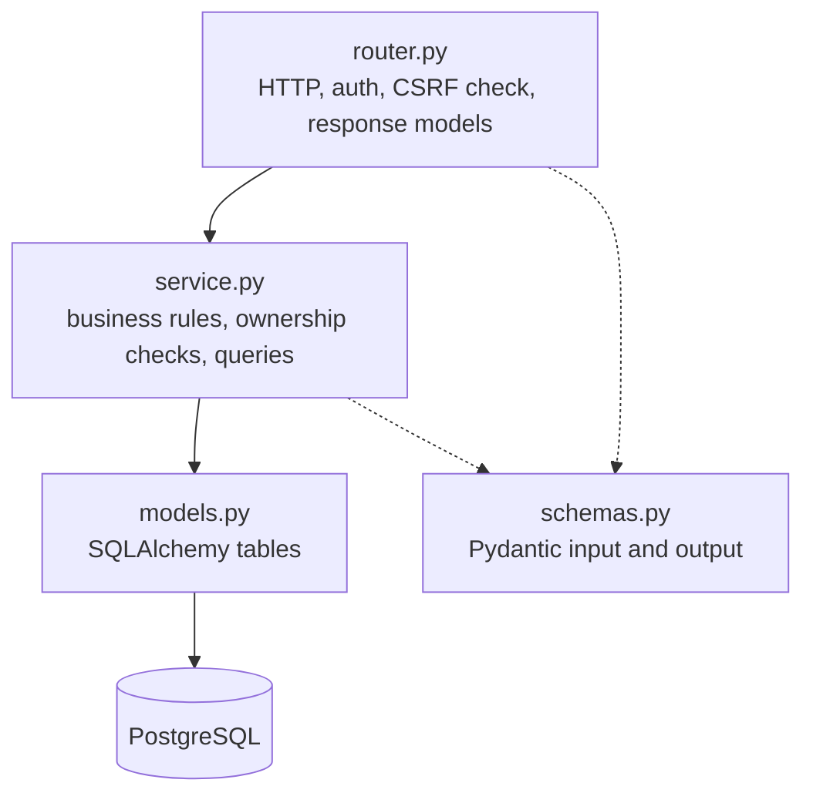
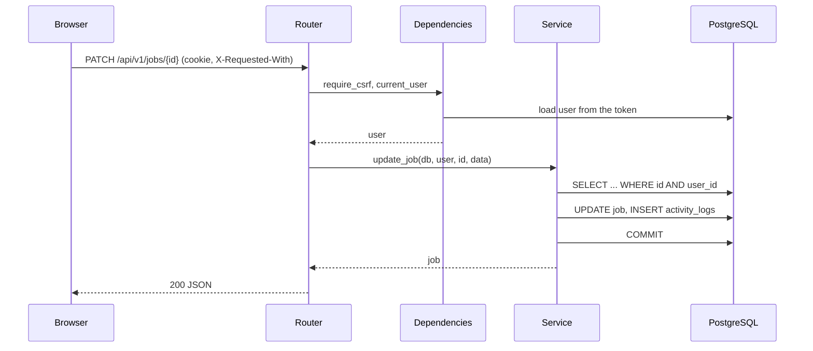

# Architecture

CareerLab is a monorepo with three parts: a Next.js frontend, a FastAPI backend and a
PostgreSQL database. `docker-compose.yml` runs all three locally.

The browser only talks to the frontend's origin. Next.js forwards `/api/v1/*` to the API
(`rewrites` in `frontend/next.config.ts`), so the session cookie is first-party and CORS is not
needed in a deployment that uses this proxy. The rewrite target comes from `API_URL` and is fixed
when the frontend is built. Locally, the API also allows the one origin set in `FRONTEND_ORIGIN`.

`GET /health` and the Swagger docs (`/docs`, `/openapi.json`) are served by the API directly.

## Backend

`backend/app/` is organised as one module per domain, each split into the same layers:

- **Domains:** `auth`, `jobs`, `research`, `contacts`, `reminders`, `notes`, `activity`,
  `dashboard`.
- **Routers contain no queries.** They validate input, call one service function and return
  the result.
- **Every service function takes the current user** and filters by `user_id`. A record that is
  missing or belongs to someone else raises `404`, so the API does not reveal that it exists.
- **Shared code** is in `app/core/`: settings, the database engine, the error envelope, list
  pagination and sorting, password hashing and tokens, and the in-memory rate limiter.
- **Polymorphic links** (notes, reminders, contact links and activity rows pointing at a job,
  research opportunity or contact) cannot use foreign keys. `app/modules/entities.py` checks that
  the target belongs to the user before a link is created, and removes the dependents when the
  target is deleted.
- **Activity logs** are written by the services in the same transaction as the change they
  describe. The dashboard reads them back. Rows are never updated or deleted by the app.
- **Migrations** are Alembic scripts in `backend/alembic/versions/`. The Docker image runs
  `alembic upgrade head` before it starts Uvicorn.

### A request, step by step

## Authentication

- Passwords are hashed with Argon2.
- Login sets `careerlab_session`, a signed JWT (HS256) in an `HttpOnly`, `SameSite=Lax` cookie
  that expires after 7 days. It is `Secure` when `COOKIE_SECURE=true`.
- The token carries the user's `token_version`. Changing the password increments it, which signs
  out every other device.
- `POST`, `PATCH` and `DELETE` need the header `X-Requested-With: CareerLab`, otherwise the API
  returns `403`.
- The login and register endpoints are rate limited in memory. See [api.md](api.md).

## Frontend

`frontend/` is a Next.js App Router app.

- `app/(auth)/` holds the login and register pages. `app/(app)/` holds everything behind login,
  inside a shared shell with the sidebar and header bell.
- `proxy.ts` redirects visitors without a session cookie to `/login`. It only checks that the
  cookie exists. The API is the real authority, and the client sends the user to login when the
  API answers `401`.
- `lib/api.ts` is the single typed API client. It adds the CSRF header to mutations and turns
  every failure into an `ApiError`.
- TanStack Query handles data fetching and caching. Every data view has a loading skeleton, an
  empty state and an error state with a retry button.
- List filters, sort order, page and view (table or Kanban) are kept in the URL.
- Kanban drag and drop uses dnd-kit. A move updates the card at once and rolls back with an error
  message if the save fails.
- The security headers `X-Frame-Options`, `X-Content-Type-Options` and `Referrer-Policy` are set
  in `next.config.ts`.

## Docker and CI

- `docker compose up` starts `db` (PostgreSQL 16, also creates the `careerlab_test` database on
  first start), `api` (port 8000) and `web` (port 3000).
- The API image contains the application, the migrations and `scripts/`, and leaves out tests.
  It runs as a non-root user.
- `.github/workflows/ci.yml` runs backend lint, type checks and tests, the frontend lint,
  type check and build, a gitleaks scan of the full history, and on pull requests the Playwright
  end-to-end suite against the full Compose stack.
