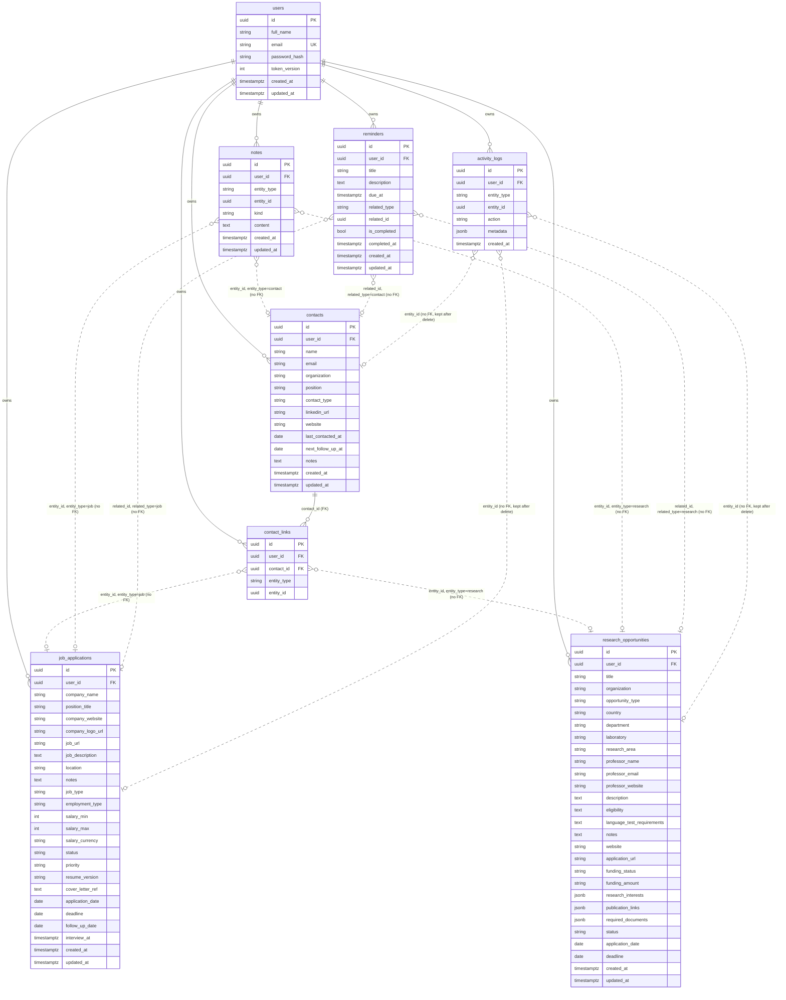

# Database

PostgreSQL 16, managed with Alembic migrations in `backend/alembic/versions/`. Models are in
`backend/app/modules/*/models.py`.

## Conventions

- Every table uses a UUID primary key.
- Every user-owned table has `user_id`, a foreign key to `users` with `ON DELETE CASCADE`.
- Main tables have `created_at` and `updated_at` (timestamps with time zone, stored in UTC).
- Enums are stored as plain text, with `CHECK` constraints added in the migrations.
- `date` fields (deadlines, application dates) are stored as dates with no time zone conversion.
- Deletes are permanent. Deleting a job, research opportunity or contact removes its notes,
  reminders and contact links in the same transaction. Activity logs are kept.

## ER diagram

Solid lines are real foreign keys. Dotted lines are polymorphic links: the row stores a type and
an id, and there is **no foreign key** because the target can be in one of several tables. The
service layer checks that the target exists and belongs to the user, and returns `404` if not.



## Tables

### users

Name, unique lowercase email, Argon2 hash and `token_version`. Changing the password increments
`token_version`, which invalidates existing session tokens.

### job_applications

- `status`: `wishlist` (default), `preparing`, `applied`, `assessment`, `interview`, `offer`,
  `rejected`, `withdrawn`.
- `priority`: `low`, `medium` (default), `high`.
- `job_type` is the work arrangement (`on_site`, `remote`, `hybrid`). `employment_type` is the
  contract (`full_time`, `part_time`, `internship`, `contract`, `temporary`).
- A `CHECK` constraint requires `salary_min <= salary_max` when both are set.

### research_opportunities

- `status`: `discovered` (default), `interested`, `contacted_professor`, `preparing_documents`,
  `applied`, `interview`, `accepted`, `rejected`, `archived`.
- `funding_status`: `fully_funded`, `partially_funded`, `self_funded`, `unknown` (default).
- `opportunity_type`: `research_assistant`, `research_internship`, `graduate_research_program`,
  `fully_funded_phd`, `masters_scholarship`, `fellowship`, `research_collaboration`,
  `visiting_researcher`.
- `research_interests` is a list of strings, `publication_links` a list of `{title, url}` and
  `required_documents` a checklist of `{name, done}`, all stored as JSONB.

### contacts and contact_links

A contact can be linked to any number of jobs and research opportunities. A contact survives when
a linked job or opportunity is deleted, and only the link row is removed. `contact_links` is unique
on `(contact_id, entity_type, entity_id)`. `entity_type` is `job` or `research`.

### reminders

`due_at` is required and must include a UTC offset. `related_type` and `related_id` are either both
set or both null (a `CHECK` constraint). A reminder due right now counts as upcoming, not overdue.

### notes

`entity_type` is `job`, `research` or `contact`. `kind` is `note` (default), `interview_feedback`
or `communication`. A note stays on the record it was written on.

### activity_logs

Append-only history written by the services in the same transaction as the change. `action` is one
of `created`, `status_changed`, `deadline_updated`, `interview_scheduled`, `contact_added`,
`archived` or `deleted`. `metadata` stores the item's label, and old and new values for status and
deadline changes, so history stays readable after the item is deleted. Timestamps use
`clock_timestamp()` so events written in one transaction keep their order.

## Indexes

| Table | Index |
|---|---|
| `job_applications`, `research_opportunities` | `(user_id, status)`, `(user_id, deadline)`, `(user_id, created_at)` |
| `reminders` | `(user_id, due_at, is_completed)` |
| `notes`, `activity_logs`, `contact_links` | `(user_id, entity_type, entity_id)` |
| `activity_logs` | `(user_id, created_at)` |
| `contacts` | `(user_id, next_follow_up_at)` |

## Migrations

```bash
cd backend
alembic upgrade head       # apply every migration
alembic current            # show the applied revision
```

The Docker image runs `alembic upgrade head` on every start.
